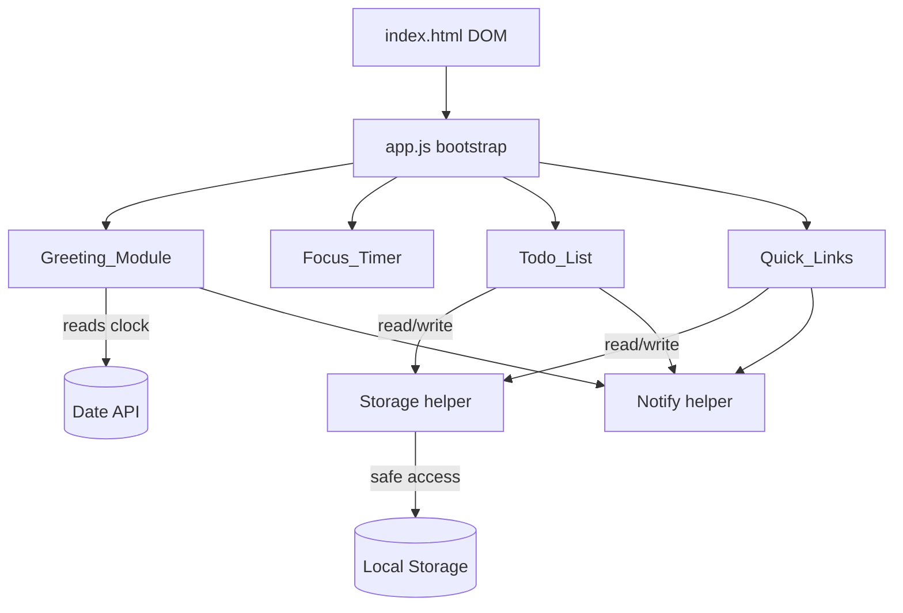
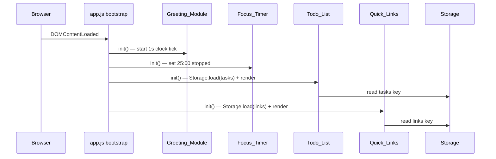
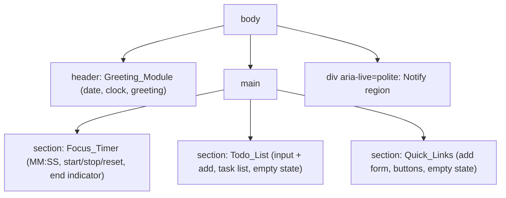

# Design Document

## Overview

The Todo List Life Dashboard is a fully client-side single-page web application built with HTML, CSS, and vanilla JavaScript. It presents four independent features on one screen: a live clock with a time-based greeting (Greeting_Module), a 25-minute focus countdown (Focus_Timer), an editable to-do list (Todo_List), and a set of customizable quick links (Quick_Links). Task and quick-link data persist in the browser's Local Storage so they survive page reloads and browser restarts. There is no backend server; all logic runs in the browser.

The design honors the following user constraints:

- **Stack**: HTML for structure, CSS for styling, vanilla JavaScript only — no frameworks, no build step.
- **Storage**: Browser Local Storage API only; everything is client-side.
- **Compatibility**: Modern evergreen browsers (Chrome, Firefox, Edge, Safari). The app is self-contained so it works equally as a standalone page or packaged as a browser extension (new-tab / popup page).
- **Non-functional**: Clean minimal interface, fast first paint (static assets, no network dependency), responsive interactions, clear visual hierarchy, readable typography.
- **Folder rules**: Exactly one CSS file in `css/` and exactly one JavaScript file in `js/`.
- **Testing**: No automated test framework or setup is required. Correctness properties are documented to guide manual verification and to make the intended behavior explicit, but no test runner is to be installed.

### Project File Structure

```
/ (web root)
├── index.html          # Single page: all four components
├── css/
│   └── styles.css       # The one and only CSS file
└── js/
    └── app.js           # The one and only JavaScript file (all modules)
```

The single `app.js` file is internally organized into logically separated modules (see Components and Interfaces). Keeping everything in one file satisfies the folder rule while still allowing clean, readable separation through an IIFE/module-object pattern.

## Architecture

### High-Level Architecture

The application follows a lightweight **module + view-render** pattern. Each feature is an independent module inside `app.js` with its own in-memory state, its own DOM render function, and (where applicable) its own Local Storage access through a shared Storage helper. Modules do not depend on each other; they only share two cross-cutting helpers: `Storage` (safe Local Storage read/write) and `Notify` (user-facing error/status messages).



### Bootstrap Flow

On `DOMContentLoaded`, the bootstrap routine initializes each module in order. Each module caches its DOM references, loads persisted state (Todo_List and Quick_Links read from Local Storage), performs an initial render, and wires up event listeners.



### Rendering Strategy

The application uses a **render-from-state** approach for Todo_List and Quick_Links: the in-memory array is the single source of truth, and a `render()` function rebuilds the relevant DOM list from that array after every mutation. This keeps the DOM and state consistent and avoids partial-update bugs. Greeting_Module and Focus_Timer update specific text nodes on their timer ticks rather than rebuilding, since they have fixed structure.

### Persistence Strategy

Only Todo_List and Quick_Links persist. The pattern for both is **mutate in memory → attempt to persist → on failure, surface an error while keeping the in-memory change visible** (Requirements 3.5, 4.5, 5.4, 6.3, 9.2). The sole exception is a blocked save being treated as an error indication; the in-memory/displayed state remains so the user does not silently lose work.

## Components and Interfaces

All components live inside `js/app.js`. Each is expressed as a module object (e.g. `const Todo = (function(){ ... })();`) exposing a small public interface and keeping internal state private.

### Shared Helper: Storage

Centralizes all Local Storage access with error handling so individual modules never touch `localStorage` directly.

```
Storage.read(key) -> { ok: boolean, value: string|null }
Storage.write(key, value) -> { ok: boolean }
Storage.loadJSON(key) -> { ok: boolean, data: any|null, corrupt: boolean }
Storage.saveJSON(key, data) -> { ok: boolean }
```

- `read`/`write` wrap `localStorage.getItem`/`setItem` in try/catch to tolerate security exceptions (private mode, disabled storage) and quota errors.
- `loadJSON` reads then `JSON.parse` inside try/catch; sets `corrupt: true` when parsing or shape validation fails (Requirements 7.4, 9.5).
- `saveJSON` serializes with `JSON.stringify` and delegates to `write`.

### Shared Helper: Notify

Displays transient, accessible status/error messages in a dedicated DOM region (`aria-live="polite"`).

```
Notify.error(message)   // shows an error indication
Notify.info(message)    // shows a status indication
Notify.clear()
```

### Greeting_Module

Responsibilities: display current time (HH:MM:SS) and date (day, month, year), update time every second, and show a greeting chosen by Time_Of_Day. (Requirements 1.1–1.7)

```
Greeting.init()          // cache DOM, render once, start 1s interval
Greeting.renderClock()   // read Date, format time + date, update DOM
Greeting.greetingFor(hour) -> "morning" | "afternoon" | "evening"
```

- `greetingFor(hour)` is a pure function used for the time-of-day rule (1.4–1.6): hours 5–11 → morning, 12–17 → afternoon, 18–23 and 0–4 → evening.
- A `setInterval` of 1000 ms drives updates (1.3). The clock render is wrapped in try/catch; a thrown/invalid `Date` leads to `Notify.error` and a placeholder in the clock region (1.7).

### Focus_Timer

Responsibilities: a 25-minute countdown with start, stop, and reset, plus an end indication. (Requirements 2.1–2.7)

```
Timer.init()        // set remainingSeconds = 1500, state = "stopped", render
Timer.start()       // if stopped, enter running; if already running, no-op (2.3)
Timer.stop()        // pause, retain remainingSeconds (2.4)
Timer.reset()       // state = "stopped", remainingSeconds = 1500 (2.5)
Timer.tick()        // decrement by 1; at 0 -> stop + end indication (2.6)
Timer.format(sec) -> "MM:SS"   // two-digit minutes and seconds
```

Internal state: `remainingSeconds` (integer), `state` ("stopped" | "running"), and an interval handle. `start()` is idempotent while running (2.3): it only creates an interval if none is active. `format` is a pure function producing zero-padded `MM:SS` (2.1, 2.7).

### Todo_List

Responsibilities: add, edit, complete/uncomplete, delete tasks; persist and restore; validate input; show empty state. (Requirements 3–7)

```
Todo.init()                 // load from Storage, render
Todo.add(text)              // validate, append, persist, render
Todo.edit(id, text)         // validate, replace text, persist, render
Todo.toggle(id)             // flip done, persist, render
Todo.remove(id)             // delete, persist, render
Todo.validateText(text) -> { ok: boolean, reason?: "empty"|"too_long", value?: string }
Todo.render()               // rebuild list DOM from state, show empty state if length 0
```

- `validateText` trims, then enforces the 1–500 character rule shared by add (3.1–3.3) and edit (4.1–4.3).
- Each mutation calls `Storage.saveJSON`; a failed save keeps the in-memory change and triggers `Notify.error` (3.5, 4.5, 5.4, 6.3).
- `render()` shows an empty-state element when there are zero tasks (6.4, 7.3).
- Tasks render in stored order (7.1).

### Quick_Links

Responsibilities: add and remove quick links, open them in a new tab, validate input, persist/restore, show empty state. (Requirements 8–9)

```
Links.init()                    // load from Storage, render
Links.add(label, url)           // validate, append, persist, render
Links.remove(id)                // delete, persist, render
Links.open(id)                  // window.open(url, "_blank")
Links.validate(label, url) -> { ok: boolean, field?: "label"|"url", data?: {label,url} }
Links.render()                  // rebuild buttons from state (max 50), empty state if none
```

- `validate` enforces: label 1–50 chars, URL 1–2048 chars and beginning with `http://` or `https://` (8.1–8.2).
- `open` uses `window.open(url, "_blank")` with `noopener` for safety (8.3).
- `render()` displays at most 50 buttons (9.3) and an empty-state indicator when none exist (8.5, 9.4).

## Data Models

### Task

Represents one to-do item (Glossary: Task).

| Field  | Type    | Constraints                                   |
|--------|---------|-----------------------------------------------|
| id     | string  | Unique identifier (e.g. timestamp + counter)  |
| text   | string  | 1–500 characters after trimming               |
| done   | boolean | `true` = done, `false` = not done             |

```json
{ "id": "1718000000000-0", "text": "Write the design doc", "done": false }
```

### Quick_Link

Represents one saved favorite site (Glossary: Quick_Link).

| Field | Type   | Constraints                                            |
|-------|--------|--------------------------------------------------------|
| id    | string | Unique identifier                                      |
| label | string | 1–50 characters                                        |
| url   | string | 1–2048 characters, begins with `http://` or `https://` |

```json
{ "id": "1718000000001-0", "label": "RevoU", "url": "https://revou.co" }
```

### Local Storage Schema

Two independent keys hold JSON-serialized arrays. No other keys are used.

| Key                   | Value shape        | Written by  |
|-----------------------|--------------------|-------------|
| `dashboard.tasks`     | `Task[]`           | Todo_List   |
| `dashboard.quicklinks`| `Quick_Link[]`     | Quick_Links |

- Order in the array is the display order (7.1).
- On load, each array is shape-validated per element. If the value is missing, the module uses an empty array (7.3, 9.4). If the value exists but is not valid JSON or fails shape validation, it is treated as corrupt (7.4, 9.5), with differing recovery behavior per the requirements (see Error Handling).

### In-Memory State (transient, not persisted)

- Greeting_Module: none beyond the interval handle.
- Focus_Timer: `remainingSeconds` (int), `state` ("stopped" | "running"), interval handle.

### HTML Page Structure

`index.html` provides a single semantic layout with four labeled regions and the required asset links (one CSS file, one JS file).



Structural outline:

```html
<head>
  <link rel="stylesheet" href="css/styles.css">
</head>
<body>
  <header id="greeting">…date, time, greeting…</header>
  <main>
    <section id="timer">…MM:SS display, Start/Stop/Reset, end indicator…</section>
    <section id="todo">…new-task input, add button, <ul> list, empty state…</section>
    <section id="links">…label+url inputs, add button, button list, empty state…</section>
  </main>
  <div id="notify" aria-live="polite"></div>
  <script src="js/app.js"></script>
</body>
```

Using semantic landmarks (`header`, `main`, `section`) with associated headings provides the clear visual hierarchy and readability called for by the non-functional requirements, and supports accessibility.

## Correctness Properties

*A property is a characteristic or behavior that should hold true across all valid executions of a system — essentially, a formal statement about what the system should do. Properties serve as the bridge between human-readable specifications and machine-verifiable correctness guarantees.*

The properties below capture the input-varying, logic-bearing behavior of the dashboard. They are documented to make intended behavior explicit and to guide manual verification. Per the user's constraint, no automated test framework is to be set up (see Testing Strategy).

### Property 1: Time-of-day greeting mapping

*For any* integer hour in the range 0–23, `greetingFor(hour)` returns "morning" when the hour is 5–11, "afternoon" when the hour is 12–17, and "evening" when the hour is 18–23 or 0–4; every hour maps to exactly one greeting band.

**Validates: Requirements 1.4, 1.5, 1.6**

### Property 2: Timer display format round-trip

*For any* remaining-seconds value in the range 0–1500, `format(sec)` produces a string matching two-digit minutes and two-digit seconds separated by a colon (`MM:SS`), and parsing that string back yields minutes × 60 + seconds equal to the original `sec`.

**Validates: Requirements 2.1, 2.7**

### Property 3: Timer reset returns to canonical state

*For any* timer state (stopped or running) and *any* remaining-seconds value, invoking `reset()` yields the stopped state with remaining time equal to exactly 1500 seconds (25:00).

**Validates: Requirements 2.5**

### Property 4: Task text validation classification

*For any* input string, `validateText` accepts it (ok) exactly when its trimmed length is between 1 and 500 inclusive; otherwise it rejects with reason "empty" when the trimmed string is empty and reason "too_long" when the trimmed length exceeds 500.

**Validates: Requirements 3.1, 3.2, 3.3, 4.1, 4.2, 4.3**

### Property 5: Adding a valid task appends exactly one not-done task

*For any* task list and *any* string whose trimmed length is 1–500, adding it increases the list length by exactly one, and the new task's stored text equals the trimmed input with a completion state of not done, while all pre-existing tasks remain unchanged and in order.

**Validates: Requirements 3.1**

### Property 6: Editing a task preserves list shape and only changes text when valid

*For any* task in the list and *any* candidate edit text: when the trimmed text is 1–500 characters the task's text becomes the trimmed value and nothing else changes (same id, same done state, same list length and order); when the trimmed text is invalid the task is left entirely unchanged.

**Validates: Requirements 4.1, 4.2, 4.3**

### Property 7: Task completion toggle is an involution

*For any* task, toggling its completion state once flips it, and toggling it twice returns it to its original completion state, leaving its id and text unchanged.

**Validates: Requirements 5.1, 5.2**

### Property 8: Deleting a task removes exactly that task

*For any* task list and *any* id present in it, removing that id yields a list that no longer contains the id, has length reduced by exactly one, and preserves the relative order and content of all remaining tasks.

**Validates: Requirements 6.1**

### Property 9: Tasks persistence round-trip

*For any* list of valid tasks, saving it to Local Storage and then loading it back yields an equivalent list — the same tasks with the same text and completion states in the same order.

**Validates: Requirements 7.1, 7.2, 3.4, 4.4, 5.3, 6.2**

### Property 10: Quick link validation classification and field identification

*For any* label/URL pair, `validate` accepts it exactly when the label length is 1–50 and the URL length is 1–2048 and the URL begins with "http://" or "https://"; otherwise it rejects and identifies the offending field (label or url), leaving the set of links unchanged.

**Validates: Requirements 8.1, 8.2**

### Property 11: Deleting a quick link removes exactly that link

*For any* set of quick links and *any* id present in it, removing that id yields a set that no longer contains the id, has length reduced by exactly one, and preserves the remaining links and their order.

**Validates: Requirements 8.4**

### Property 12: Quick links persistence round-trip with render cap

*For any* list of valid quick links, saving it to Local Storage and loading it back yields an equivalent list in the same order, and rendering displays a number of buttons equal to the smaller of the list length and 50.

**Validates: Requirements 9.1, 9.3**

## Error Handling

All Local Storage access flows through the `Storage` helper so error handling is uniform and testable. The guiding principle is: never silently lose the user's in-memory work; surface a clear, accessible error instead.

### Clock / Date retrieval failure (Requirement 1.7)

`Greeting.renderClock()` wraps date reading and formatting in try/catch. On failure it calls `Notify.error("Time or date is currently unavailable.")` and renders a placeholder in the clock/date region rather than leaving it blank or crashing the interval.

### Local Storage write failure (Requirements 3.5, 4.5, 5.4, 6.3, 9.2)

`Storage.write` / `saveJSON` catch exceptions (quota exceeded, security errors in private mode, storage disabled) and return `{ ok: false }`. Every mutating operation (add, edit, toggle, delete for tasks; add, delete for quick links) follows this sequence:

1. Apply the change to the in-memory array and re-render (so the UI reflects the user's action).
2. Call `Storage.saveJSON`.
3. If it returns `{ ok: false }`, call `Notify.error` with a message specific to the action (e.g. "Task could not be saved.", "Changes could not be saved.", "Deletion did not persist.", "Quick link change was not saved.").

The in-memory/displayed state is intentionally retained on save failure, matching the requirements. The sole nuance is that Quick_Links keeps its set "unchanged" from the user's perspective: the attempted change is still shown, and the error tells the user it was not persisted.

### Invalid / corrupt stored task data (Requirement 7.4)

`Storage.loadJSON("dashboard.tasks")` sets `corrupt: true` when the value is present but not parseable as a `Task[]` (bad JSON or element shape). Todo_List then:

1. Uses an empty task list and renders the empty state.
2. On the next write operation, overwrites the corrupt value with the current (valid) task array — effectively discarding the unreadable data.

### Invalid / corrupt stored quick-link data (Requirement 9.5)

`Storage.loadJSON("dashboard.quicklinks")` sets `corrupt: true` similarly. Quick_Links then:

1. Renders zero buttons.
2. Does **not** overwrite the stored value on load. The unreadable data is preserved until the user performs the next add or delete, at which point the valid current set is written over it.

This asymmetry between tasks (overwrite on next write) and quick links (preserve until next mutation) is deliberate and traces directly to Requirements 7.4 versus 9.5.

### Missing stored data (Requirements 7.3, 9.4)

A missing key is not an error. `loadJSON` returns `data: null, corrupt: false`, and the module initializes with an empty array and empty-state rendering.

### Input validation failures (Requirements 3.2, 3.3, 4.2, 4.3, 8.2)

Validation happens before any state mutation. Invalid input is rejected, the existing state is left unchanged, and `Notify.error` reports the specific problem (empty text, maximum length exceeded, or which Quick_Link field is invalid).

### Opening quick links safely (Requirement 8.3)

Links open with `window.open(url, "_blank", "noopener")` to prevent the opened page from accessing `window.opener`. Because URLs are validated to begin with `http://` or `https://`, non-web schemes are rejected at input time.

## Testing Strategy

Per the user's explicit constraint, **no automated test framework or test setup is required for this feature**. No test runner, assertion library, or property-based testing dependency is to be installed, and the single-CSS-file / single-JS-file folder rule is preserved (no test directories or files are added to satisfy a framework).

The correctness properties above are therefore documented as a specification of intended behavior and a checklist for lightweight manual verification, not as automated test cases. The design intentionally keeps the property-bearing logic in small pure functions (`greetingFor`, `format`, `validateText`, `Links.validate`, and the array mutation helpers) so that behavior is easy to reason about and, should the user later choose to add tests, these functions are directly testable without DOM or storage setup.

### Manual verification checklist

Verification is done by exercising the app in a modern browser:

- **Greeting (Properties 1; Req 1.1–1.7)**: Load the page; confirm time (HH:MM:SS), date (day/month/year), and a greeting appear and that the seconds advance. Spot-check the greeting band by temporarily adjusting the system clock across the morning/afternoon/evening boundaries. Simulate a clock failure to confirm the error indication.
- **Focus Timer (Properties 2, 3; Req 2.1–2.7)**: Confirm initial `25:00` stopped state; start and watch it decrement; press start again while running and confirm it does not reset; stop and confirm the value is retained; reset and confirm it returns to `25:00` stopped; let it (or fast-check a short value) reach `00:00` and confirm it stops with an end indication.
- **Todo List (Properties 4–9; Req 3–7)**: Add valid tasks; try empty/whitespace and over-500-character text and confirm rejection with the right message; edit a task with valid and invalid text; toggle completion on and off; delete tasks including the last one to see the empty state; reload the page to confirm tasks persist in order; corrupt the `dashboard.tasks` value in dev tools to confirm it falls back to empty and is overwritten on the next change.
- **Quick Links (Properties 10–12; Req 8–9)**: Add valid links; try invalid label/URL combinations and confirm the field-specific error; click a link to confirm it opens in a new tab; delete a link; reload to confirm persistence; corrupt the `dashboard.quicklinks` value to confirm zero buttons render and the bad data is preserved until the next add/delete.

### Cross-browser verification

Manually smoke-test the checklist in Chrome, Firefox, Edge, and Safari, and confirm the layout remains clean and readable at narrow and wide viewport widths (responsive interactions and clear visual hierarchy per the non-functional requirements).
